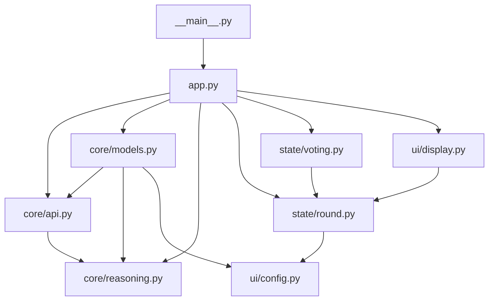
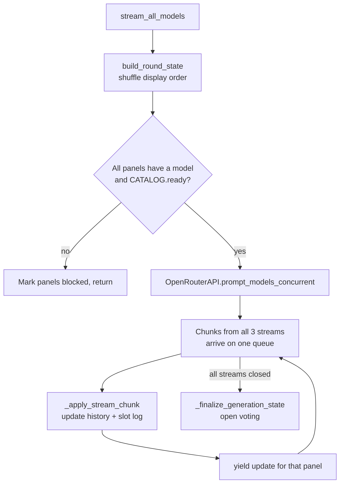

# Architecture

The app is one Python package, `arena`, with about 2,900 lines of code. It has three
runtime dependencies, `gradio`, `httpx`, and `python-dotenv`.

## Module map

```text
arena/
  __init__.py         # Python version check
  __main__.py         # main(): set up data files, load catalog, launch Gradio
  app.py              # Gradio layout, event handlers, streaming loop, persistence
  assets/icon.png     # Browser tab icon (package data)
  core/
    api.py            # OpenRouter HTTP client and concurrent streaming
    models.py         # Model catalog loading, CatalogState, fallback catalog
    reasoning.py      # Reasoning capability detection, payloads, price hints
  state/
    round.py          # Round state dict, anonymous labels, display shuffling
    voting.py         # Ranking logic and vote button updates
  ui/
    config.py         # Constants: default models, panel count, file paths
    display.py        # Chat message building, stats footer, leaderboard rows
```



## Startup

`main()` in `__main__.py` runs three steps in order:

1. `bootstrap_persistence()` creates `arena_logs/` and an empty `meta.json`, and migrates
   a legacy `votes.json` if one exists.
2. `initialize_model_catalog()` calls `load_model_catalog()`, which reads `.env` from the
   working directory, checks
   the key, fetches the catalog, and returns a `CatalogState`. It is stored in the
   module-level `app.CATALOG`.
3. `create_demo()` builds the Gradio `Blocks` from `CATALOG`, and the app launches.

Importing `arena.app` does not touch the network or `.env`. Until step 2 runs, `CATALOG`
holds the fallback list with `ready=False`. A test (`test_import_purity.py`) guards this.

## The catalog

`CatalogState` (`core/models.py`) is a frozen snapshot of the model list plus the lookups
built from it: models by id, providers for the first dropdown, models per provider, and
the three default picks.

`ready` is `True` only when the live catalog loaded. It controls the status banner,
whether the dropdowns and Send button are enabled, and whether `stream_all_models` will
call OpenRouter at all.

If a default model id is missing from the live catalog, that panel falls back to the first
model from the same provider, then to the first model overall.

## A round in code

`stream_all_models()` in `app.py` is an async generator wired to the Send button. Gradio
also exposes it as the `/stream_all_models` API endpoint, which is why it checks
`CATALOG.ready` itself instead of relying on the disabled button. Each `yield` pushes a
UI update to Gradio.



`prompt_models_concurrent()` (`core/api.py`) starts one task per model. Each task streams
server-sent events from `/chat/completions` and puts parsed chunks on a shared
`asyncio.Queue`. A `None` on the queue marks the end of one stream. Every stream ends with
exactly one `complete` or `error` chunk, and a failure in one model never stops the
others.

Chunk shapes:

| Event | Key fields |
| --- | --- |
| content (no `event` key) | `slot`, `delta` |
| `reasoning` | `slot`, `reasoning_details` (accumulated so far) |
| `complete` | `slot`, `usage`, `reasoning_details`, `stats` |
| `error` | `slot`, `error`, optional `response` body |

## Round state

The round lives in a plain dict held by a `gr.State`. `state/round.py` builds it, and the
event handlers replace it with an updated copy on each step. Key fields:

- `display_order`, a list such as `[2, 0, 1]`. Position is the panel (`Response A` is
  position 0), and the value is the selection slot (column) whose model is shown there.
- `slot_logs`, one dict per column with model info, status, response text, reasoning,
  usage, and cost. This is what gets saved.
- `vote_stage`, which moves through `streaming`, `pick_first`, `pick_second`,
  `ready_submit`, and `submitted`, or `unavailable` if every panel failed.

## Persistence

All file writing lives in `app.py`, from `_write_text_file` down to
`_persist_vote_submission`. See [Data files](data.md#how-saves-stay-consistent) for the
behaviour.

## Configuration

There is no settings file. To change behaviour, edit `arena/ui/config.py`:

| Constant | Purpose |
| --- | --- |
| `DEFAULT_MODEL_IDS` | Models preselected in the three columns |
| `DEFAULT_SYSTEM_PROMPT` | Starting system prompt |
| `SITE_URL`, `SITE_NAME` | Sent to OpenRouter as `HTTP-Referer` and `X-Title` for attribution |
| `DATA_DIR` | Folder for `.env`, `votes.jsonl`, and `arena_logs/`. It is the working directory at startup |
| `APP_ICON_PATH` | Browser tab icon, shipped inside the package at `arena/assets/icon.png` |

`PANEL_COUNT` is also defined there, but the voting flow assumes exactly three panels
(1st, 2nd, and an automatic 3rd), so changing it needs code changes too.

The fallback catalog in `core/models.py` repeats the three default ids with display
labels. Update both places together.
