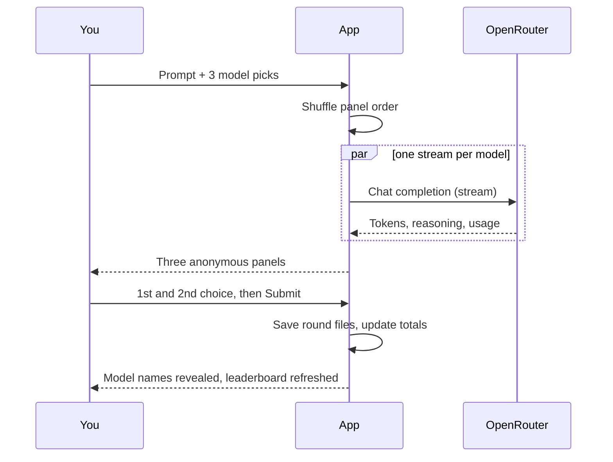

# Using the arena

The app has two tabs, **Arena** and **Leaderboard**.

## A round, step by step

1. **Pick three models.** Each of the three columns at the top has a provider dropdown and
   a model dropdown. The same model can be picked more than once.
2. **Set reasoning effort** if a column shows the dropdown (see
   [Reasoning controls](#reasoning-controls)).
3. **Optionally edit the system prompt.** It is under the collapsed **System Prompt**
   section and defaults to `You are a helpful assistant.` All three models get the same
   one.
4. **Type a prompt and press Send.** Enter adds a new line in the prompt box.
5. **Watch the answers stream in.** Before the round starts, the app shuffles which model
   goes in which panel, so the left column's model is not necessarily in
   `Response A`.
6. **Rank the answers** once all three have finished.
7. **Submit the vote.** The round is saved, the panel headers switch from
   `Response A/B/C` to the real model names, and the leaderboard updates.

Changing any provider or model dropdown clears the panels and discards an unsubmitted
round.

Each round is a single prompt and three single replies. There is no follow-up turn.



## Voting

Voting opens when every panel has either finished or failed, and at least one finished.

- Click the button for your favourite response. It is marked `1st`.
- Click your second choice. It is marked `2nd`, and the remaining response is marked `3rd`
  automatically.
- **Reset Vote** clears your picks so you can start again.
- **Submit Vote** saves the round. A green banner confirms the save, or a red one explains
  why it failed.

A panel that errored can still be ranked. Nothing is written to disk until you submit, so a
round you skip leaves no trace.

## Reasoning controls

Under each model dropdown, the app may show a **Reasoning effort** dropdown. It appears
only when the model's OpenRouter metadata lists `reasoning` support. The choices are
`none`, `minimal`, `low`, `medium`, `high`, and `xhigh`. It defaults to the model's own
default if OpenRouter reports one, otherwise `medium`.

What gets sent:

| Choice | Request field |
| --- | --- |
| `none` | `"reasoning": {"effort": "none"}` |
| any other level | `"reasoning": {"effort": "<level>", "exclude": false}` |
| model has no dropdown | no `reasoning` field |

`exclude: false` asks OpenRouter to return the reasoning trace. Providers differ in what
they actually expose. Some return full text, some a summary, and some only an encrypted
blob or a token count.

Next to the dropdown there is a price hint such as `input $3/M; output $15/M`. It comes from
the OpenRouter catalog, in US dollars per million tokens. A separate reasoning price is
shown only when it differs from the output price. The hint is a rough guide, since real
cost depends on how many reasoning tokens the model uses and which provider OpenRouter
routes to.

## What each panel shows

During and after streaming, a panel can contain up to four kinds of messages:

- **The answer** itself.
- **🔎 Reasoning Trace**, a collapsible block with the reasoning the provider returned. If
  reasoning was requested but nothing came back, it says the trace was not exposed.
- **🛠️ Generation Stats**, a collapsible footer, for example:

    ```text
    TTFT: 0.84s
    Total time: 6.12s
    Tokens/sec: 71.3 tok/s
    Completion tokens: 377
    Reasoning tokens: 128
    Finish reason: stop
    API cost: $0.006132
    ```

- **Warnings and errors**, such as an HTTP error from OpenRouter or a reasoning setting the
  model could not accept.

Requests time out after 60 seconds without data from OpenRouter.

## Leaderboard

The Leaderboard tab ranks every model that has appeared in a submitted round.

| Column | Meaning |
| --- | --- |
| Wins | Rounds where the model was ranked 1st |
| Appearances | Submitted rounds the model was in, including rounds where it errored |
| Win Rate | Wins divided by appearances |

Rows are sorted by wins, then by appearances, then by name. If the same model filled two
panels in one round, it gets two appearances.

The leaderboard reads `arena_logs/meta.json`, which also keeps 2nd and 3rd place counts,
error counts, token totals, and total cost per model. Those extra totals are not shown in
the UI. See [Data files](data.md#arena_logsmetajson).
